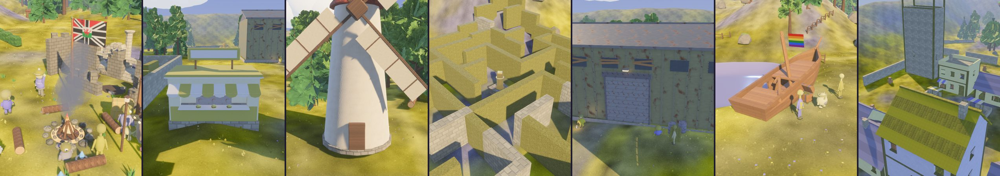

# friendSLOP



A multiplayer game that **nobody is designing**. Friends throw ideas over the wall, Claude builds
them, and whatever passes CI ships. Expect chaos.

- 🌐 **Play in your browser:** **https://cumsauce.github.io/friendSLOP/**, rebuilt automatically
  from every change to `main` (allow the mic for voice chat).
- 🎮 **Play:** grab the build for your OS from [Releases → latest](../../releases/tag/latest).
  One person presses **H** to host (a join code is copied to their clipboard) and shares the code.
  Everyone else copies it and presses **J**. Talk with your mic, **M** to mute.
- 💡 **Add an idea:** see below.
- 🤖 **How it gets built:** [AGENTS.md](AGENTS.md) · current state: [GAME_DESIGN.md](GAME_DESIGN.md)

## How to add an idea

- **On Discord:** type `/idea`. Use `/whatsneeded` to see what the game still lacks, and `/answer` to
  reply to Claude's questions.
- **On GitHub:** [open an idea issue](../../issues/new?template=idea.yml).

Any size is fine: "there should be a frog", "the floor is lava on Tuesdays", "we're all trying to
build a rocket". Claude interprets it, builds it, and tells you how it turned out.

## Developing

```sh
nix develop          # or: Rust stable + (Linux) libasound2-dev libudev-dev libwayland-dev libxkbcommon-dev
cargo run -- host
cargo run -- join <code>
```

On non-NixOS Linux the dev shell sets up PipeWire audio for you (`ALSA_PLUGIN_DIR` /
`ALSA_CONFIG_PATH`; set them yourself to override). Nix binaries can't see the host's
Vulkan driver, though, so if the game says "Unable to find a GPU", opt in to
[nixGL](https://github.com/nix-community/nixGL) for that run (not a dependency of the flake):

```sh
nix develop -c nix run --impure github:nix-community/nixGL#nixVulkanIntel -- cargo run -- host
# nixVulkanNvidia / nixGLDefault for other drivers
```
